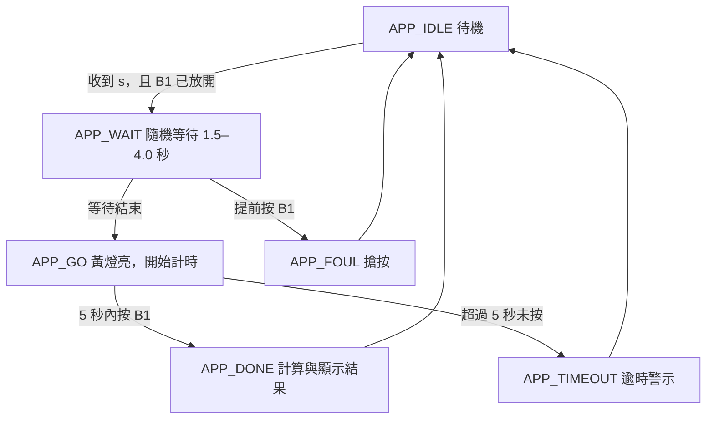

STM32 煞車反應時間測試系統（Brake Reaction Time Test）
以 STM32 NUCLEO-G474RE 製作駕駛煞車反應時間測試。使用者透過電腦上的 Tera Term 輸入 s，系統隨機等待 1.5～4.0 秒後點亮黃色 LED；使用者看到黃燈後按下板載藍色 B1 按鈕，系統測量反應時間，並以 40 km/h 換算反應距離。若黃燈亮起後 5 秒仍未按下，則進入逾時警示。
注意： 此專題計算的是「反應期間前進的距離」，不是實際制動距離或總停車距離。最新版本的 B1 輪詢與逾時功能仍應以實體開發板測試結果確認。

專題功能
- [x] 使用 USART2 與 Tera Term 進行序列通訊（115200 baud）
- [x] 輸入 s 啟動測試流程
- [x] 隨機等待 1.5～4.0 秒後亮起黃色 LED
- [x] 使用 TIM2 進行微秒級反應時間計算（設定目標：1 μs/count）
- [x] 以 40 km/h 換算反應距離
- [x] 記錄測試次數及最佳反應時間
- [x] 設計搶按（FOUL）及 5 秒逾時（TIMEOUT）判斷
- [x] 使用紅色 LED 與蜂鳴器提供警示
- [x] 提供蜂鳴器及 GPIO 診斷指令
- [ ] 完成所有功能的實體板驗證（尤其 B1 偵測與逾時警示）
硬體設備與接腳
元件	STM32 腳位	用途
NUCLEO-G474RE	—	主控制器
黃色 LED	PA6	開始反應的視覺提示
紅色 LED	PB1	搶按／逾時警示
主動式蜂鳴器	PA8（Arduino D7）	聲音提示；透過 NPN 電晶體驅動
板載藍色 B1 按鈕	PC13	模擬踩下煞車
USART2 TX/RX	PA2 / PA3	透過 ST-LINK 虛擬序列埠連接電腦
TIM2	MCU 內部	反應時間計時

蜂鳴器採用外部 NPN 電晶體（例如 2N2222）驅動，PA8 不直接供應蜂鳴器負載電流。接線時須確認共地與電晶體方向。
操作方式
1. 將 NUCLEO-G474RE 連接電腦並下載程式。
2. 開啟 Tera Term，選擇開發板對應的 COM Port，設定 115200、8-N-1。
3. 放開 B1 按鈕，在 Tera Term 輸入 s。
4. 等待隨機 1.5～4.0 秒，黃色 LED 突然亮起。
5. 看到黃燈後立即按下藍色 B1 按鈕。
6. 查看 Tera Term 顯示的反應時間、反應距離及最佳紀錄。
7. 放開 B1，再輸入 s 進行下一次測試。
例外情況： 黃燈亮起前按下 B1，判定為 FOUL；黃燈亮起後 5 秒內未按下，判定為 TIMEOUT，預期紅燈亮起並發出聲音提示。
Tera Term 指令
指令	功能
s / S	啟動反應時間測試
b / B	蜂鳴器測試（約 500 ms）
0	關閉蜂鳴器
p / P	查詢 PA8 腳位狀態
c / C	查詢 PC13（B1）腳位狀態

有限狀態機（FSM）

- APP_IDLE：等待指令。
- APP_WAIT：黃燈熄滅，進行隨機等待。
- APP_GO：黃燈亮起，開始計算反應時間。
- APP_DONE：完成測試並顯示成績。
- APP_FOUL：過早按下 B1。
- APP_TIMEOUT：黃燈亮起後超過 5 秒未反應。
程式架構
函式／元件	主要功能
SystemClock_Config()	設定 MCU 系統時鐘
MX_GPIO_Init()	設定 LED、B1 與蜂鳴器相關腳位
MX_USART2_UART_Init()	初始化 USART2
AppInit()	初始化 TIM2、LED、蜂鳴器及開機說明
AppPoll()	主迴圈中的 UART 指令、狀態轉換、按鈕與逾時檢查
SetLeds()	控制黃色及紅色 LED
BuzzerStart() / BuzzerPoll() / BuzzerOff()	非阻塞式蜂鳴器控制
SendText()	傳送文字至 Tera Term
HAL_GPIO_EXTI_Callback()	保留的 PC13 中斷回呼；最新版本另以輪詢作為 B1 偵測方式

htim2 在 tim.c 中定義；`main.c` 使用 extern TIM_HandleTypeDef htim2; 參照，避免重複定義造成 linker error。
計算方式
TIM2 在計時器時鐘為 170 MHz、Prescaler 為 169 時，計數頻率為：
170,000,000 / (169 + 1) = 1,000,000 Hz
1 count = 1 μs
反應時間：
reaction_us = B1 被偵測時的 TIM2 計數 - 黃燈亮起時的 TIM2 計數
reaction_ms = reaction_us / 1000
以 40 km/h ≈ 11.11 m/s 為例，若反應時間為 0.235 秒：
反應距離 = 車速 × 反應時間
         = (40 / 3.6) × 0.235
         ≈ 2.61 m
預期序列埠輸出示例
以下數值為示意，非實際量測紀錄。
=== BRAKE REACTION TEST ===
Speed: 40 km/h; reaction distance only (before braking).
Release BLUE B1, then type s to start.

[TEST 1] Reaction: 235.421 ms | Reaction distance: 2.62 m
Best: 235.421 ms
Release button, then type s for next test.
開發環境
- 開發板：ST NUCLEO-G474RE
- 開發工具：STM32CubeIDE / STM32CubeMX
- 終端機：Tera Term
- 程式語言：C（STM32 HAL）
測試與注意事項
- 黃燈隨機亮起的流程已在開發過程中觀察到運作。
- B1 偵測及 5 秒逾時警示曾發生無反應情況，最新輪詢版本仍需重新實測確認。
- GPIO 輪詢的反應時間可能受到主迴圈執行時間影響；若要進一步提高時間精度，可在確認 EXTI 設定後改採中斷捕捉。
- 若 Tera Term 重複顯示開機訊息，需排查 MCU 是否重新啟動。
專題目的
透過此專題練習 STM32 的 GPIO、UART、TIM2 計時器、狀態機設計、按鈕偵測與非阻塞式控制，並將反應時間量測應用到交通安全情境。
